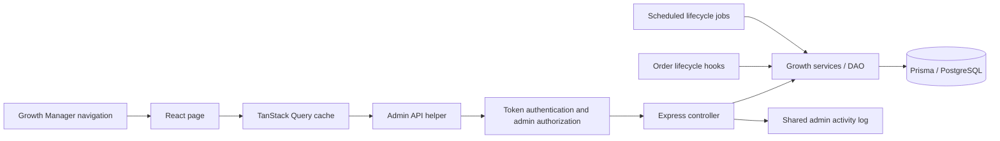
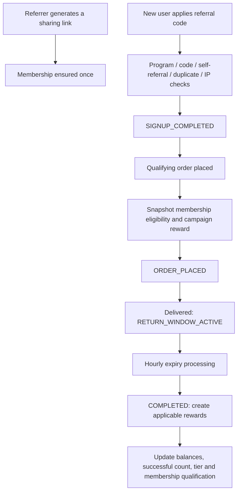

# Growth Module: Features, Architecture, and Working Flows

> Implementation status update — 25 October 2026: this document records the original static analysis. Subsequent fixes, verification results and remaining runtime checks are recorded in [current implementation context](GROWTH_FIX_CONTEXT.md). No migration was run.

Analysis date: 25 October 2026.

This document describes the checked-in implementation of the admin Growth Manager, including Marketing, Affiliates, Refer & Earn, Membership, Fraud & Risk, Activity Log, and the shared Growth components. Backend services were traced to explain what the screens actually do. This is a static code analysis; it does not establish that the deployed services, database contents, or scheduled jobs are healthy.

## 1. Module overview

Growth Manager is an admin control area for customer acquisition, partner commissions, referral incentives, membership qualification, and operational review.

There are three different concepts that should be kept separate:

| Concept | Responsibility |
| --- | --- |
| Referral membership | Determines whether the referrer is eligible to earn on an order; trial, active, and lapsed states |
| Referral performance tiers | Track successful referrals and can replace the default flat referrer reward |
| Campaigns | Temporarily replace the normal referral reward or affiliate commission calculation for matching orders/items |

The `Components/Growth/` directory is a shared UI library. Most business logic lives in page components, API helpers, and backend services rather than in that directory.

## 2. Sidebar and routing

### Actual Growth navigation

The Growth menu is defined in [Components/Sidebar/index.jsx](src/Components/Sidebar/index.jsx), and routes are registered in [App.jsx](src/App.jsx).

| Menu group | Screen | Route | Implementation |
| --- | --- | --- | --- |
| Acquisition | Marketing Dashboard | `/marketing/dashboard` | [Marketing/Dashboard](src/Pages/Marketing/Dashboard/index.jsx) |
| Acquisition | Campaigns | `/campaigns` | [Marketing/Campaigns](src/Pages/Marketing/Campaigns/index.jsx) |
| Acquisition | Notification Templates | `/notification-templates` | [Marketing/Templates](src/Pages/Marketing/Templates/index.jsx) |
| Partners & Referrals | Affiliates | `/affiliate` | [Affiliate/Dashboard](src/Pages/Affiliate/Dashboard/index.jsx) |
| Partners & Referrals | Membership | `/membership` | [Membership](src/Pages/Membership/index.jsx) |
| Partners & Referrals | Refer & Earn | `/referral` | [Referral/Dashboard](src/Pages/Referral/Dashboard/index.jsx) |
| Operations | Fraud & Risk | `/fraud-risk` | [FraudRisk](src/Pages/FraudRisk/index.jsx) |
| Operations | Activity Log | `/activity-logs` | [Marketing/ActivityLogs](src/Pages/Marketing/ActivityLogs/index.jsx) |

Affiliate and Referral sidebar entries use prefix matching. [GrowthSubNav](src/Components/GrowthSubNav/index.jsx) adds section tabs for these two route families:

- Affiliate: Dashboard, Applications, Affiliates, Commission Rates, Payouts, Fraud Logs, Settings.
- Referral: Dashboard, Configuration, Users, Transactions, Rewards, Withdrawals, Fraud Logs.

Membership uses tabs inside its own page. Marketing screens have individual sidebar entries.

### Role of the requested `UI/sidebar.tsx`

[Components/UI/sidebar.tsx](src/Components/UI/sidebar.tsx) defines generic sidebar primitives: provider/context, menu items, groups, triggers, rail, submenus, skeletons, and tooltips. It contains no Growth menu definitions or Growth business logic.

Its supported behavior includes desktop expansion/collapse, a mobile Sheet drawer, icon/offcanvas/non-collapsible modes, left/right positioning, and Ctrl/Cmd+B toggling. `setOpen` writes a seven-day `sidebar_state` cookie, but this file does not read that cookie to restore state automatically.

The current `App.jsx` imports `Components/Sidebar`, and no import of `UI/sidebar` was found under `src`. Therefore the generic component's keyboard shortcut and cookie behavior should not be assumed to describe the active admin sidebar.

## 3. Request and data flow



The admin route wrapper uses `useAdminAuth` and redirects unauthenticated users to `/login`. Backend Growth admin routers independently apply `authenticateToken` and `requireAdmin`.

API helpers read `admin_token` from local storage, send it as a Bearer token, and build URLs from `VITE_API_BASE_URL`. Backend mounting uses `/api/admin/...`, so the configured base URL must supply the appropriate API prefix.

Pages generally use `useQuery` for loading and `useMutation` for writes. Successful writes invalidate relevant query keys and show a toast; failures appear inline or in an error toast. Several paginated lists retain previous data while loading the next result. Response shapes vary: referral lists expose named arrays and `pagination`, affiliate lists expose `items` and `total`, and campaigns/templates expose `data`.

Sources: [API helpers](src/utils/adminReferralApi.js), [affiliate API helper](src/utils/adminAffiliateApi.js), [campaign API helper](src/utils/adminCampaignApi.js), [backend route mounting](../backend-deployed/server.js).

## 4. Marketing Dashboard

Source: [Marketing/Dashboard/index.jsx](src/Pages/Marketing/Dashboard/index.jsx).

### Features

- Live campaign count and total count.
- Live campaigns ending within seven days.
- Rewards attributed, combining referral rewards and affiliate commissions.
- Redemptions, calculated from campaign `used_count` values.
- Charts for attributed rewards by channel and campaign lifecycle distribution.
- Top six campaigns ranked by attributed amount, with a channel filter on that ranking.
- Manual Refresh and Manage campaigns actions.

### How it works

The dashboard calls `listCampaigns()` under query key `["marketing", "campaigns", "all"]`, with a 30-second stale time. It computes KPI values and chart groups in the browser from the returned campaign array. The ranking channel filter does not filter the dashboard-wide KPI calculations.

Lifecycle display follows this order: inactive flag, ended date, future start date, otherwise live. Lifecycle labels are computed when the component renders; there is no dedicated interval that moves a campaign between states at a date boundary.

**Metric meaning:** “Rewards attributed” is incentive money associated with campaigns, not sales revenue, profit, or return on ad spend. Backend attribution sums completed referral referrer rewards and affiliate breakdown commissions in `APPROVED`, `IN_PAYOUT`, or `PAID` states. Redemptions represent reserved campaign/order uses; they are not necessarily completed purchases or paid rewards.

Source for attribution: [campaign.dao.js](../backend-deployed/dao/campaign.dao.js).

## 5. Campaigns

Sources: [Campaigns page](src/Pages/Marketing/Campaigns/index.jsx), [admin controller](../backend-deployed/controller/campaignAdminController.js), [campaign engine](../backend-deployed/services/campaignEngine.js).

### Admin features

| Feature | Behavior |
| --- | --- |
| List | Shows name, scope, schedule, channel, reward, usage, attributed amount, and lifecycle |
| Filter | Active/inactive flag is filtered by the server; channel is filtered locally |
| Create/edit | Sheet form with basics, schedule, scope, reward, and eligibility fields |
| Activate/deactivate | Flips `is_active`; does not rewrite the schedule |
| Delete | Confirmation required; used campaigns are deactivated instead of deleted |
| Category lookup | Loads active categories, cached for five minutes |
| Product lookup | Debounced search while a product-scoped form is open |

### Form fields and validation

Campaign fields are name, internal description, `REFERRAL`/`AFFILIATE` channel, start/end timestamps, active flag, and optional total usage limit. Each campaign has one reward rule:

- Scope: `STORE_WIDE`, `CATEGORY`, or `PRODUCT`; non-store scopes require a scope ID.
- Reward type: `PERCENTAGE` or `FIXED`.
- Positive reward value; percentages cannot exceed 100.
- Optional maximum reward cap and minimum eligible order value.

The browser requires a name, valid schedule order, positive reward, and a chosen scoped entity. The backend also validates enumerated values, date validity, UUID format, finite monetary bounds, non-negative optional money fields, and a positive integer usage limit. Browser-local date inputs are converted to ISO timestamps before submission.

### Matching and pricing

1. Load active rules for the channel with `starts_at <= now < ends_at`.
2. Match product/category IDs using specificity: **product > category > store-wide**.
3. Check the chosen rule's minimum order value against the whole order's eligible base.
4. Reserve a campaign usage slot atomically.
5. Calculate the reward and persist the resulting campaign snapshot.
6. If no usable rule is selected, use the program's normal calculation.

The shared eligible base is:

```text
eligible base = max(0, subtotal - coupon_discount - discount_charge)
percentage reward = base × reward_value / 100
fixed reward = reward_value
rule amount = round to 2 decimals(max(0, min(reward, optional cap)))
```

Source: [rewardCalculation.js](../backend-deployed/services/rewardCalculation.js).

### Referral versus affiliate behavior

| Question | Referral channel | Affiliate channel |
| --- | --- | --- |
| Matching unit | One decision for the whole order; any matching item can qualify it | Decision per order-item line |
| Calculation base | Whole eligible order base | Discount-adjusted item-line value |
| Multiple campaigns per order | One selected campaign | Multiple distinct campaigns can contribute |
| Normal rate interaction | Replaces flat/tier referrer reward | Replaces category/default rate and tier bonus for matching lines |
| Other customer bonus | Referee bonus continues to come from referral configuration | Not part of affiliate commission calculation |
| Historical snapshot | Campaign ID/name and final applied reward value | Per-item `campaign_breakdown`; scalar campaign ID only when exactly one contributes |

Affiliate order-level discounts are allocated proportionally across item lines. A usage slot is reserved once per distinct campaign/order, even if several lines match that campaign. Unique `(campaign_id, order_id)` usage rows and a guarded increment prevent ordinary retries from consuming extra slots.

**Important implementation detail:** the affiliate calculation calls the cap calculation separately for each line. The form labels the cap “Maximum reward per order,” but current affiliate behavior can exceed that amount when several matching lines each receive a capped reward. A fixed affiliate reward is also applied per matching line, not once per order or once per quantity unit.

Example: a ₹50 cap with two matching lines that each calculate ₹80 produces ₹100 total affiliate commission under that campaign. The referral path applies its cap once to the order reward.

### Lifecycle and deletion

“Active” filtering means `is_active = true`; it includes scheduled and ended campaigns. “Live” requires the schedule window as well. Usage-limit exhaustion is checked by the engine, not incorporated into the displayed lifecycle badge.

Deleting a campaign with any `campaign_usage` history only sets it inactive, preserving references. A campaign without usage history can be deleted with its rule. Both actions generate activity events.

## 6. Notification Templates

Sources: [Templates page](src/Pages/Marketing/Templates/index.jsx), [template controller](../backend-deployed/controller/notificationTemplateAdminController.js), [template service](../backend-deployed/services/notificationTemplateService.js).

Admins can edit an existing notification type's title and message, preview placeholders, save each card independently, discard edits, or reset a customized card to its built-in copy. Cards show supported variables, customization state, unsaved changes, and server validation errors. Unsaved edits register a browser reload/tab-close warning.

| Notification type | Supported variables |
| --- | --- |
| `REFERRAL_SIGNUP` | `referee_name` |
| `REFERRAL_ORDER_PLACED` | None |
| `REFERRAL_ORDER_DELIVERED` | None |
| `REWARD_CREDITED` | `amount`, `validity_days` |
| `WITHDRAWAL_REQUESTED` | `amount` |
| `REWARD_EXPIRED` | `amount` |
| `REWARD_EXPIRING_SOON` | `amount` |
| `REWARD_EXPIRING_URGENT` | `amount` |
| `ADMIN_CREDIT_RECEIVED` | `amount`, `validity_days` |
| `WITHDRAWAL_REJECTED` | `amount`, `reason` |
| `WITHDRAWAL_COMPLETED` | `amount` |

The listing merges the built-in registry with database overrides, so even uncustomized types appear. Saving upserts `notification_templates`; resetting deletes the override. At notification creation, an active override wins, otherwise the default is rendered with event variables. Edits affect subsequently rendered notifications.

This screen controls copy for the existing in-app referral notification flow. It is not a bulk campaign sender or an email/SMS/WhatsApp editor. New notification event types require code support.

Use exact `{{variable}}` tokens. The frontend preview accepts spaces around variable names, while backend extraction/interpolation currently accepts only the compact form; `{{ amount }}` can preview differently from actual delivery.

## 7. Refer & Earn

### Screens and capabilities

| Screen | Route | Features |
| --- | --- | --- |
| Dashboard | `/referral` | Pending withdrawals, monthly conversions and comparison, credited rewards, enrolled users, transactions, signup trend, status breakdown, top referrers, tiers |
| Configuration | `/referral/config` | Program gates, flat rewards, lifetime earning cap, reward validity, order minimum, first-order setting, return window, withdrawals, tier ladder, IP protection, notifications |
| Users | `/referral/users` | Debounced search, status/tier filters, referral codes, balances, earnings, block/unblock, code activation, manual credit |
| Transactions | `/referral/transactions` | Search by referee/code/order; status, order value, reward amount, date, failure reason; paginated read-only list |
| Rewards | `/referral/rewards` | Status filter, original/remaining money, expiry, manual credit, extend expiry, cancel usable reward |
| Withdrawals | `/referral/withdrawals` | Status filter, payment details, approve, reject, record completed transfer |
| Fraud Logs | `/referral/fraud-logs` | Referral-only investigation view |

Sources: [Referral pages](src/Pages/Referral), [admin API helper](src/utils/adminReferralApi.js), [admin controller](../backend-deployed/controller/adminReferralController.js).

### Referral lifecycle



Applying a valid referral code creates the referrer/referee relationship and transaction, increments pending statistics, and sends a signup notification. A guarded relationship claim prevents the same referee from being attached twice.

Order placement finds a `SIGNUP_COMPLETED` transaction and checks the configured order minimum. It snapshots membership earning eligibility and attempts campaign matching. Delivery starts the return window; hourly processing credits rewards after that window expires.

The referrer's amount uses the stored campaign reward when present. Otherwise the service calculates the configured flat/tier amount and applies its lifetime earning cap. The referee's bonus uses configuration. If membership was ineligible at placement, the referrer receives no reward while the referee can still receive their bonus.

Normal referral tiers are derived from successful-referral thresholds. Achieved tier updates are monotonic in the credit flow. Reward amount selection still evaluates configured thresholds when calculating a non-campaign reward, so a retained badge and the currently selected reward threshold are distinct behaviors.

Full and partial returns invoke reversal/adjustment services. Valid affiliate attribution takes priority over a pending referral on the same order via `supersedeByAffiliateAttribution`.

Sources: [referralService.js](../backend-deployed/services/referralService.js), [orderLifecycleHooks.js](../backend-deployed/services/orderLifecycleHooks.js).

### Rewards and withdrawals

Reward states shown in the UI are `ACTIVE`, `PARTIALLY_USED`, `FULLY_USED`, `EXPIRED`, and `CANCELLED`. Rewards track original and remaining amounts. Both admin manual-credit entry points submit a fixed seven-day validity. Manual credit does not itself start a membership trial.

Withdrawal approval moves `PENDING → APPROVED`. Rejection is allowed from pending/approved states and returns reserved money to the user. Recording payment accepts approved/processing requests and completes the withdrawal. The UI collects transaction/gateway references; it records a transfer already made rather than initiating a bank transfer.

Backend transitions use status guards and transactions to avoid repeated balance movement. The UI lists `FAILED` as a filter, but its available actions are approve, reject, and mark paid.

## 8. Affiliates

### Screens and capabilities

| Screen | Route | Features |
| --- | --- | --- |
| Dashboard | `/affiliate` | Pending applications/payouts/commissions, active affiliates, attributed orders, trends, commission breakdown, top affiliates |
| Applications | `/affiliate/applications` | Status filter, detail drawer, platform/promotion/contact/payment details, approve or reject with reason |
| Affiliates | `/affiliate/affiliates` | Status filter, profile drawer, earnings/balances, tier and status changes, blocking with reason |
| Commission Rates | `/affiliate/commission-rates` | Category overrides, default-rate context, create/edit/delete custom rates |
| Payouts | `/affiliate/payouts` | Gross/TDS/net breakdown, payment details, mark paid or failed, transaction reference and notes |
| Fraud Logs | `/affiliate/fraud-logs` | Affiliate-only investigation view |
| Settings | `/affiliate/config` | Program/application/link gates, default commission, tier setting, tracking duration, self-referral protection, hold days, payout and TDS settings |

Sources: [Affiliate pages](src/Pages/Affiliate), [affiliate admin controller](../backend-deployed/controller/affiliateAdminController.js), [affiliate service](../backend-deployed/services/affiliateService.js).

### Partner workflow

An application is reviewed or automatically approved according to configuration. Approved partners have affiliate profiles and can generate links through customer-facing affiliate endpoints. Clicking a link records tracking information. After order placement, the client conversion endpoint supplies the order, affiliate code, and optionally a click ID.

The conversion controller verifies order ownership. The service checks that the affiliate is active and unblocked; a supplied click must belong to that affiliate, match its bound customer if present, remain unexpired, and be unconverted. Configured self-referral blocking also creates an affiliate fraud case.

Commission calculation uses discounted product value. Without a matching campaign, an active category override wins over the default rate and the profile's tier bonus is added. With a campaign, that campaign replaces the normal calculation for the matching line. The profile editor assigns Bronze/Silver/Gold/Platinum bonuses of 0/0.5/1/2 percentage points.

Delivery starts the commission hold window. The hourly job approves eligible commissions after the window, with balance and commission records updated by the service. Returns can reverse unpaid commission. A full return after payment is recorded as an absorbed loss rather than creating a clawback debt.

Sources: [affiliateTrackingController.js](../backend-deployed/controller/affiliateTrackingController.js), [affiliateService.js](../backend-deployed/services/affiliateService.js).

### Payout processing

The UI records completion/failure of a payout, rather than sending money. Backend status transitions support a broader workflow:

```text
PENDING    → APPROVED / PROCESSING / COMPLETED / FAILED / REJECTED
APPROVED   → PROCESSING / COMPLETED / FAILED / REJECTED
PROCESSING → COMPLETED / FAILED
```

Terminal transitions are guarded. Completion marks linked commissions paid and reduces processing balance. Failure/rejection returns net money to available balance and releases commissions back to approved state. TDS settings belong to the commission/payout backend; this guide describes configured behavior rather than tax-law compliance.

The API helper also exposes order lists, commission lists, and approve/cancel commission operations. These do not have separate registered Growth pages in the inspected `App.jsx`; API availability should not be confused with a visible admin screen.

## 9. Membership

Sources: [Membership page and tabs](src/Pages/Membership), [membership admin controller](../backend-deployed/controller/membershipAdminController.js), [membership service](../backend-deployed/services/membershipService.js).

### Admin features

- Overview: trial/active/lapsed counts, qualification rate of concluded trials, trials ending soon, and active-plan context.
- Members: search, status filtering, sorting, pagination, qualification progress, and a detail drawer.
- Detail: plan, referral code, performance tier, trial/lapse dates, counted referrals, and membership status history.
- Plan editing: name, trial duration, referral target, grace period, and active status; a confirmation lists changes.

Plans must already exist in the database; the current admin page has no create-plan action. There is also no admin member-status override or paid-upgrade workflow in these screens.

### Working rules

1. A trial is created on the first successful referrer-side link generation. Repeated generation does not restart it.
2. No active plan means no new trial is created. With multiple active plans, the newest is selected.
3. Membership eligibility is captured when the referred order is placed.
4. Trial orders must be placed on or before the trial end. Grace time allows existing orders to finish; it does not extend the period for new eligible orders.
5. A referred user counts once after their qualifying order completes its return window. Reward credit and qualification updates share a transaction.
6. Reaching the target moves `TRIAL → ACTIVE`; active status is permanent in the implemented release.
7. A trial lapses after `trial_ends_at + max(plan.grace_period_days, referral.return_window_days)`.
8. Missing membership rows remain eligible for legacy/lazy-enrollment compatibility. `LAPSED` and `CANCELLED` memberships are ineligible for new referrer rewards.

`ACTIVE_PAID` exists as a recognized state, but the paid transition is explicitly a later release in the service. It should not be described as a completed feature.

Plan target and grace-period edits affect running memberships because those values are read from the related plan. Existing trial end timestamps are stored on membership rows, so changing trial duration does not recalculate their end dates. Later reward reversal does not revoke an already-qualified membership.

## 10. Fraud & Risk

Sources: [FraudRisk page](src/Pages/FraudRisk/index.jsx), [FraudLogsView](src/Components/Growth/FraudLogsView.jsx), [shared fraud service](../backend-deployed/services/referralService.js).

Referral and affiliate fraud share `referral_fraud_logs`, distinguished by a `program` field. The unified view defaults to `PENDING_REVIEW` and offers program tabs, status/severity filters, pagination, and a case drawer. Program-specific pages reuse the same component with their own API adapters.

Review decisions are confirmed fraud, false positive, under investigation, or resolved. The UI also collects review notes and an action description. The backend stores decision, reviewer, timestamps, notes, and `action_taken` metadata.

**Reviewing a case does not automatically block a user, reverse a reward, or execute the typed action.** Those consequences require the corresponding user/reward/profile operations. Successful reviews invalidate the unified and both program fraud-list caches.

Detected cases include referral self-referral/IP-limit attempts and configured affiliate self-referral attempts. Presence of a shared fraud screen does not imply a general anomaly-detection engine.

## 11. Activity Log

Sources: [ActivityLogs page](src/Pages/Marketing/ActivityLogs/index.jsx), [activity API/controller](../backend-deployed/controller/adminReferralController.js).

This is the shared operational audit view, even though its endpoint remains under `/admin/referral/activity-logs` and storage is named `referral_admin_logs`.

It supports module/action filters, debounced actor/description search, from/to dates, pagination, and a detail drawer with actor, entity, event time, and changed fields. The UI compares top-level JSON fields of previous/new snapshots; nested values are displayed as serialized objects rather than recursively diffed.

Module grouping follows action prefixes: `AFFILIATE_`, `CAMPAIGN_`, `NOTIFICATION_`, and `MEMBERSHIP_`; everything else is classified as Referral. The dropdown combines known actions with actions discovered on the current returned page.

Campaign changes, template overrides/resets, membership plan updates, referral reward/withdrawal operations, and affiliate administration emit audit events at their respective call sites. Member lifecycle history has its own `membership_status_log` and detail view. Fraud review metadata is stored on the fraud record; a shared audit row should not be assumed for every possible operation.

## 12. Shared Growth component inventory

All exports are gathered in [Components/Growth/index.js](src/Components/Growth/index.js).

| File | Responsibility and behavior |
| --- | --- |
| `PageHeader.jsx` | Standard title, description, and action area |
| `KpiCard.jsx` | KPI value, skeleton, tone, optional navigation, supplied percentage comparison |
| `StatusBadge.jsx` | Shared semantic status labels and colors; unknown statuses use neutral styling |
| `FilterBar.jsx` | Optional search input, custom filters, active-filter reset |
| `TablePagination.jsx` | Previous/next and result range; understands `pages` or `totalPages` |
| `DataGrid.jsx` | TanStack table with caller-controlled server sorting, visibility, sticky header, skeletons and row clicks |
| `ColumnsMenu.jsx` | Caller-controlled show/hide column menu |
| `ConfirmDialog.jsx` | Contextual confirmation with record details, custom inputs, loading lock, destructive styling |
| `DetailList.jsx` | Label/value details; omits empty values; optional emphasized total row |
| `States.jsx` | Empty and retryable error states |
| `FraudLogsView.jsx` | Shared fraud listing, filters, detail and review workflow |
| `ConfigLayout.jsx` | Setting sections/rows, numeric inputs, save/discard controls |
| `useConfigDraft.js` | Editable config draft, JSON-based dirty comparison, discard and server resync |
| `useUnsavedChangesWarning.js` | `beforeunload` warning for reload/tab closure; no router navigation blocker |
| `useDebouncedValue.js` | Delays search updates by 400 ms by default |
| `format.js` | INR, two-decimal INR, lakh/crore compact currency, Indian number/date formatting |
| `notify.js` | Mantine success/error toasts, normally 3/5 seconds |
| `RichText.jsx` | DOMPurify-sanitized stored HTML rendering; not a rich-text editor |

Most Marketing/Referral/Affiliate lists use the separate [UI/data-table](src/Components/UI/data-table.tsx), not `Growth/DataGrid`. `DataGrid` does not fetch, sort, or paginate server results itself. Shared Growth components are also reused outside Growth, including catalog pages; their presence in this folder does not make those pages Growth business modules.

Formatting detail: `formatINR` rounds to whole rupees; `formatINRExact` preserves two decimal places. Campaign list attribution uses the exact formatter, while several other financial displays use rounded presentation. Date formatting uses the browser's local timezone rather than an explicitly fixed business timezone.

## 13. Backend and persistence map

| Area | API root | Main implementation | Important tables |
| --- | --- | --- | --- |
| Campaigns | `/api/admin/campaigns` | `campaignAdminController`, `campaign.dao`, `campaignEngine` | `campaigns`, `campaign_rules`, `campaign_usage` |
| Referral admin | `/api/admin/referral` | `adminReferralController`, `referralService` | `user_referral_profiles`, `referral_transactions`, `referral_rewards`, `referral_reward_usages`, `referral_withdrawals` |
| Affiliate admin | `/api/admin/affiliate` | `affiliateAdminController`, `affiliateService`, `affiliate.dao` | `affiliate_applications`, `affiliate_profiles`, `affiliate_links`, `affiliate_clicks`, `affiliate_orders`, `affiliate_commissions`, `affiliate_payouts`, `affiliate_category_commissions` |
| Membership | `/api/admin/membership` | `membershipAdminController`, `membershipService` | `membership_plans`, `user_memberships`, `membership_referral_credits`, `membership_status_log` |
| Notification templates | `/api/admin/notification-templates` | `notificationTemplateAdminController`, `notificationTemplateService` | `notification_templates`; referral event notifications use `referral_notifications` |
| Fraud and activity | Under referral/affiliate admin APIs | Shared helpers in `referralService` | `referral_fraud_logs`, `referral_admin_logs` |

Schema source: [Prisma model directory](../backend-deployed/prisma/models).

### Background automation

[growthCron.js](../backend-deployed/services/growthCron.js) registers:

| Schedule | Job |
| --- | --- |
| Hourly, minute 0 | Referral return-window completion |
| Hourly, minute 0 | Affiliate commission auto-approval |
| Hourly, minute 0 | Membership lapse processing |
| Daily, 00:00 | Referral reward expiration |
| Daily, 09:00 | Referral reward expiry reminders |

No explicit timezone is passed to these cron registrations, so their wall-clock schedule follows the runtime timezone. Jobs prevent overlap within a process. With PM2 instance IDs, only instance `0` registers them; separate deployments without that coordination can still register their own jobs. [server.js](../backend-deployed/server.js) skips Growth cron initialization when `SKIP_DB` is true.

## 14. Confirmed limits and implementation mismatches

These observations come from the current code, not from runtime reproduction.

| Observation | Practical effect | Evidence |
| --- | --- | --- |
| Campaign API defaults to 20 rows; both Marketing screens omit page/limit and do not paginate campaigns | Older campaigns can disappear from management, dashboard totals/charts/ranking can be incomplete, local channel filtering only covers returned rows | [API helper](src/utils/adminCampaignApi.js), [DAO list](../backend-deployed/dao/campaign.dao.js), both Marketing pages |
| Affiliate campaign cap is applied per line despite the per-order form label | Multi-line orders can exceed the stated cap | [Campaign form](src/Pages/Marketing/Campaigns/index.jsx), [calculateCommission](../backend-deployed/services/affiliateService.js) |
| Matching sorts only by specificity, with no explicit database ordering/tie-break for equal scopes | Same-specificity overlaps do not have a defined winner policy | [campaignEngine](../backend-deployed/services/campaignEngine.js) |
| The selected best rule can fail minimum/usage checks without trying another campaign | Falls back to normal reward instead of a broader or next eligible campaign | [referral matcher](../backend-deployed/services/campaignEngine.js), [affiliate calculation](../backend-deployed/services/affiliateService.js) |
| Active flags, schedule lifecycle and remaining quota are separate | An “Active” filter result or “Live” badge does not prove a campaign can still apply | Campaign pages, DAO and engine |
| Referral campaign snapshot bypasses `calculateRewardAmounts` | The lifetime earning cap enforced by that helper is not reapplied to campaign-based referrer rewards | [processReturnWindowExpiry](../backend-deployed/services/referralService.js) |
| First-order setting is exposed, but placement consumes one signup transaction and does not consult `applicable_first_order` | Turning the setting off does not establish recurring rewards for later orders | [Referral settings](src/Pages/Referral/Config/index.jsx), [onOrderPlaced](../backend-deployed/services/referralService.js) |
| Template preview tolerates whitespace that backend tokens do not | Preview and delivered copy can differ | [Templates page](src/Pages/Marketing/Templates/index.jsx), [template service](../backend-deployed/services/notificationTemplateService.js) |
| Unsaved warning only handles `beforeunload`; campaign editor does not use that hook | In-app navigation/Sheet closure can discard edits without a dedicated warning | Growth hooks, Campaigns page |
| Cache invalidation is local to each operation's listed keys | Already-mounted dashboards, rewards or activity views may require refresh/refetch to reflect another screen's write immediately | Mutation success handlers across pages |
| Activity dates use UTC day boundaries for bare date filters, while displayed dates use browser locale | Users in other timezones can see events cross apparent day boundaries | [Activity controller](../backend-deployed/controller/adminReferralController.js), [format.js](src/Components/Growth/format.js) |

Additional boundaries: report export exists in the referral API helper/backend and returns JSON, but no dedicated export workflow is wired into the inspected Growth pages. The current payout screens record transfers; the scheduled jobs above do not execute bank payouts on the configured payout day. Paid membership and arbitrary notification-type creation are not implemented in this admin surface.

## 15. Suggested manual verification

To validate this implementation against a running environment:

1. Open every Growth sidebar entry and its Affiliate/Referral subnavigation; verify unauthorized admin API calls are rejected.
2. Create referral and affiliate campaigns with each scope; exercise future, live, ended, inactive, and exhausted states.
3. Compare more than 20 campaigns against dashboard totals and the campaign management list.
4. Place orders with overlapping rules, order discounts, multiple matching lines, minimum thresholds, and limited usage; check stored snapshots and cap behavior.
5. Deliver/cancel/partially return attributed orders; verify balances and retry behavior after lifecycle processing.
6. Generate a first referral link, qualify a trial member, and let another trial lapse; confirm grace time permits completion without allowing new eligible trial orders.
7. Save/reset notification copy with supported, unsupported, and whitespace-surrounded variables; compare preview with stored notifications.
8. Approve/reject/complete referral withdrawals and complete/fail affiliate payouts; confirm balances move once and audit/history records match.
9. Review a fraud case and confirm that actual blocking or reward cancellation remains a separate action.

No application behavior was changed as part of this analysis. These runtime scenarios were not executed for the documentation task.
